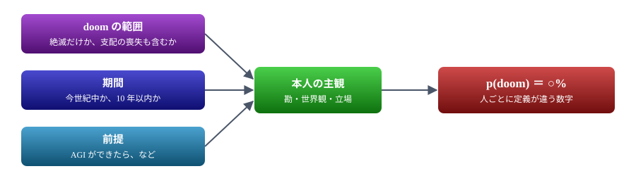
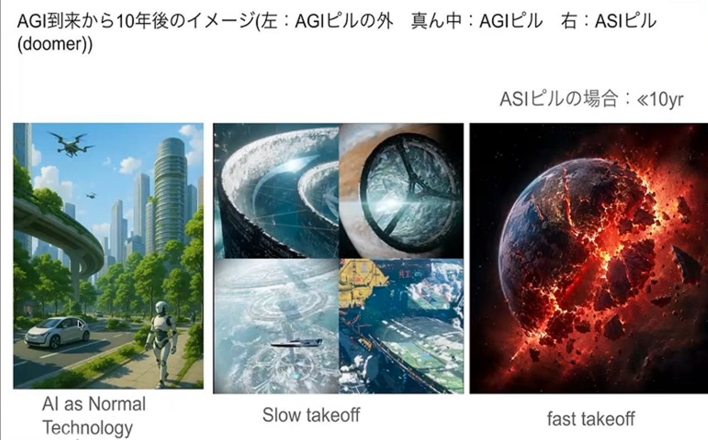
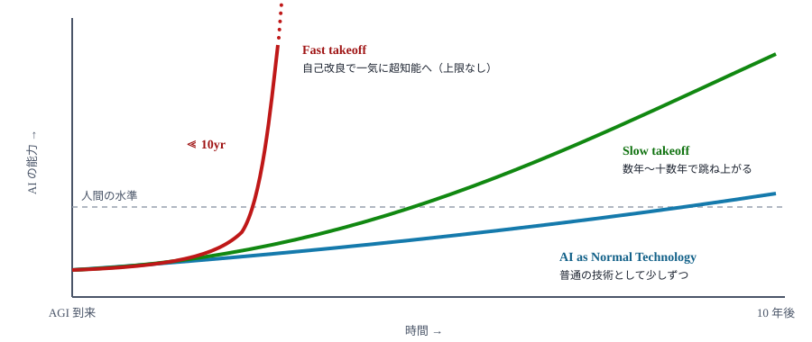
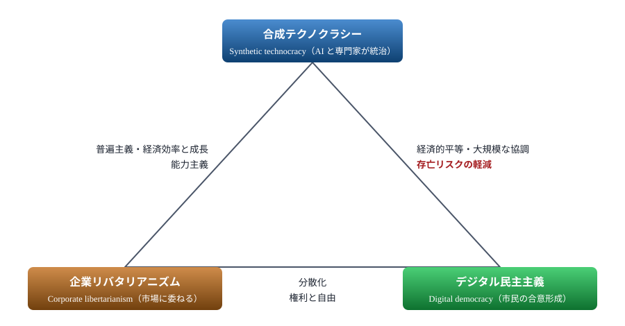
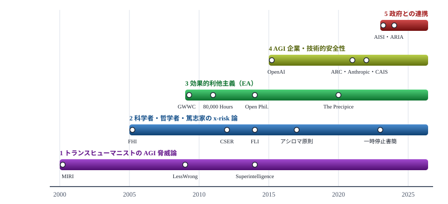
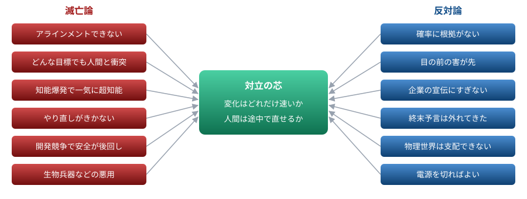
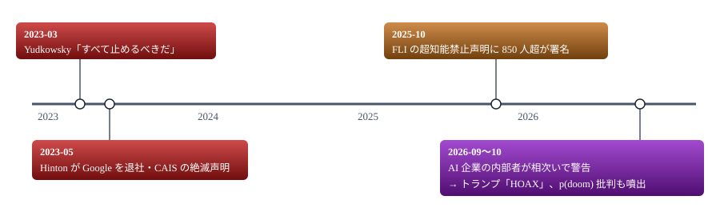
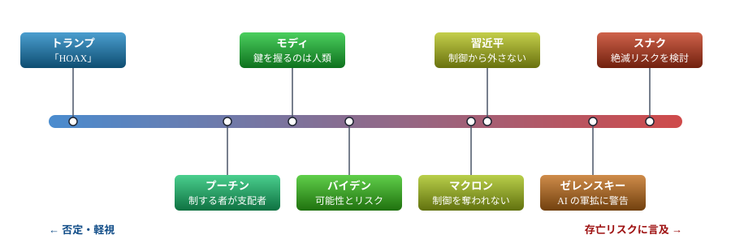
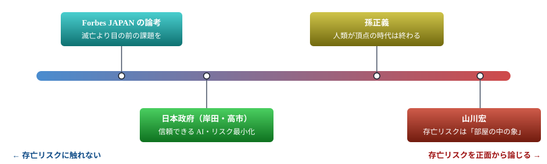

# AI p(doom) 調査

AI が人類の破局をもたらす確率 p(doom)。誰がどう見積もり、なぜ値が分かれ、世界と日本はどう反応しているか

> 📅 作成: 2026-10-03 / 更新: 2026-10-12

[⌂](../)

出典 URL は検索結果で確認できたものだけを載せる。本文まで読めなかったもの、日付を URL から推定したもの、筆者の解釈は、それぞれその旨を書く。

1. [p(doom) とは](#1-pdoom-とは)
2. [数値で見る p(doom)](#2-数値で見る-pdoom)
3. [なぜ値が分かれるか](#3-なぜ値が分かれるか)
4. [滅亡論と反対論](#4-滅亡論と反対論)
5. [ニュースの流れ](#5-ニュースの流れ)
6. [国家元首・首脳の反応](#6-国家元首首脳の反応)
7. [日本の論調](#7-日本の論調)
8. [まとめ](#8-まとめ)

## 1. p(doom) とは

**p(doom)**（ピー・ドゥーム）は probability of doom の略で、高度な AI が人類の絶滅や、取り返しのつかない破局をもたらす確率を、個人が主観で見積もった値を指す。「あなたの p(doom) は?」のように使われ、AI 安全性の研究者、AI 業界、技術系コミュニティで定番の問いになっている。言葉自体は、LessWrong や MIRI の周辺（第 3 章の系譜 1）から広まった。

- <strong>計算で出す数値ではない。</strong>どれだけ心配しているかを、確率の形で表したもの
- <strong>「doom」の範囲は人によって違う。</strong>絶滅だけを数える人もいれば、人類が将来を自分で決められなくなる事態まで含める人もいる
- **期間もそろっていない。**「今世紀中」「10 年以内」「AGI ができたら」など、前提が人ごとに異なる

同じ「p(doom)」でも、範囲・期間・前提が人ごとに違い、最後は主観で決まる。

> [!NOTE]
> **並べて比べるときの注意:** 定義も期間もばらばらなので、第 2 章の数値は厳密に比較できない。批判する側は「科学を装った雰囲気（vibes）」だと指摘している（Gizmodo, 2026-09）。Hinton 自身も「確率を言う人はみな勘で言っている」と認めている。

## 2. 数値で見る p(doom)

### 主要人物の見積もり

多くは Wikipedia の P(doom) 記事（[https://en.wikipedia.org/wiki/P(doom)](https://en.wikipedia.org/wiki/P(doom))）の表による。そこに挙がっている一次出典は、完全な URL までは確かめていない。

色は値の上限で決めた。0% が紫、100% が赤で、その間は虹色の順に変わる。濃い部分: 本人が挙げた値、または幅のある見積もりの範囲。薄い部分: 範囲の下限までの部分。数値を出していない Altman と Hassabis は載せていない。

| 人物 | 値 | 時期 | 出典・備考 |
|---|---|---|---|
| Roman Yampolskiy | 99.9% 以上 | 2024 | Wikipedia の表（Business Insider を出典とする） |
| Eliezer Yudkowsky | 95% 超 | 2023 | Wikipedia の表（Fast Company を出典とする） |
| Jan Leike | 10〜90% | 2023 | Wikipedia の表 |
| Daniel Kokotajlo（元 OpenAI） | 70% | 2026-09 | [Gizmodo](https://gizmodo.com/pdoom-is-just-vibes-masquerading-as-science-2000812009) |
| Emmett Shear | 5〜50% | 2026-09 | 同上 |
| Paul Christiano | 50% | 2023 | Wikipedia の表（Independent を出典とする） |
| Elon Musk | 10〜30% | 2024 | Wikipedia の表（Business Insider を出典とする） |
| Dario Amodei（Anthropic） | 10〜25% | 2025 | Wikipedia の表（Axios 2025-09-17 を出典とする） |
| Yoshua Bengio | 20% | 2023 | Wikipedia の表（ABC を出典とする） |
| Geoffrey Hinton | 10〜20% | 2024 / 2026-09 | 2026-09 には BBC Newsnight で 10% と発言（[Futura-Sciences](https://futura-sciences.com/en/10-is-not-unreasonable-an-ai-pioneer-warns-of-extinction-risk_39612)） |
| Lina Khan（元 FTC 委員長） | 約 15% | 2023 | Wikipedia の表（NYT を出典とする） |
| Vitalik Buterin | 12% | 2025 | Wikipedia の表 |
| Evan Hubinger（Anthropic） | 10年以内に 10% 超 | 2026-09 | [Gizmodo](https://gizmodo.com/pdoom-is-just-vibes-masquerading-as-science-2000812009) |
| Yann LeCun | 0.01% 未満 | 2024 | Wikipedia の表（TechRadar を出典とする） |
| Sam Altman | 数値なし | 2025〜2026 | 「定量化できない」という立場（Gizmodo） |
| Demis Hassabis | 数値なし | 2024 | 0 ではないと述べる（Wikipedia の表） |

### 研究者アンケート

| 調査 | 結果 | 出典 |
|---|---|---|
| AI Impacts 2023（2,778 人） | 人類の絶滅または恒久的な無力化: 中央値 5%・平均 16.2%。「制御を失う」という聞き方では中央値 10%。回答者の 57.8% が「極めて悪い結果」に 5% 以上を付けた | [AI Impacts blog](https://blog.aiimpacts.org/p/2023-ai-survey-of-2778-six-things) |
| AI Impacts 2022（NeurIPS・ICML の論文著者が対象） | 極めて悪い結果（絶滅など）: 中央値 5%。人間が制御できずに絶滅: 中央値 10% | [AI Impacts](https://aiimpacts.org/2022-expert-survey-on-progress-in-ai/) |
| AI Impacts 2024（1,580 人） | 数値は未確認（PDF が公開されていることのみ確認） | [PDF](https://aiimpacts.org/wp-content/uploads/2026/09/ESPAI2024.pdf) |

## 3. なぜ値が分かれるか

同じ AI を見ていても、0.01% から 99.9% まで値が開く。その理由を、3 枚の図で整理する。図は、YouTube の対談[「シンギュラリティサロン＆AGI Hubコラボ第２弾（その１）～『知能爆発』とは何か？bioshokさんの書籍発刊～AGIピル・AI脅威論・トランスヒューマニズム」](https://youtu.be/sCLvBXL0tdw)（チャンネル: SingularitySalon）で示されたスライドによる。以下の論者の割り当てと読み方は、筆者の整理である。

### 未来図：変化の速さ（takeoff）の想定で分かれる

スライド「AGI 到来から 10 年後のイメージ」は、立場ごとに 10 年後の世界を描き分けている。

 引用元: YouTube [「シンギュラリティサロン＆AGI Hubコラボ第２弾（その１）～『知能爆発』とは何か？bioshokさんの書籍発刊～AGIピル・AI脅威論・トランスヒューマニズム」](https://youtu.be/sCLvBXL0tdw)（チャンネル: SingularitySalon）のスライドから、スライド部分だけを切り出した。

このスライドの 3 つの世界観を、能力の伸び方として模式的に描くと次のようになる。

筆者の模式図。曲線の形は考え方を示すもので、数値に根拠はない。人間の水準を越えてから「途中で直す時間」がどれだけあるかが、立場によって大きく違う。

|  | AGI ピルの外 | AGI ピル | ASI ピル（doomer） |
|---|---|---|---|
| ラベル | AI as Normal Technology | Slow takeoff | Fast takeoff |
| 描かれた絵 | 緑の多い都市を、自動運転車・ドローン・人型ロボットが行き交う | 宇宙のリング型居住区や巨大構造物、改造された惑星 | 地球が割れて燃えている |
| 世界観 | AI は電気やインターネットと同じ「普通の技術」で、社会は少しずつ変わる | AI が数年〜十数年かけて賢くなり、文明が宇宙規模へ跳ね上がる | AI が自分自身を改良して、一気に超知能（ASI）になる。制御できなければ人類は終わる |
| 近い論者 | Narayanan と Kapoor（論考「AI as Normal Technology」, 2025）、LeCun | Christiano、Amodei | Yudkowsky（知能爆発、FOOM）、Yampolskiy |
| p(doom) | ほぼ 0 | 10〜50% | 90% 以上 |

スライドには「ASI ピルの場合：≪10yr」とも書かれている。ASI ピルの立場では、右の破局は 10 年後ではなく、それより**はるかに早く**来る、という意味である。変化がゆっくりなら途中で直せるが、一気に進むなら一発勝負になる。p(doom) の差は、主にこの速さの想定から生まれる。

### 思想の地図：何を大切にするかで分かれる

スライド「AGI ピル、AI 脅威論、の思想的／政治的地図」は、RadicalxChange の記事[「Political Ideologies for the 21st Century」](https://www.radicalxchange.org/updates/blog/political-ideologies-for-the-21st-century/)の三角形を使っている。

辺に書いたのは、両端の思想が共有する価値。「存亡リスクの軽減」を共有するのは、上と右の 2 つだけである。

- **合成テクノクラシー**: AGI を本気で信じる「AGI ピル」の側。AI 研究所の幹部や、効果的利他主義（EA）の周辺に多い。p(doom) を高く見積もる AI 安全派もここに入る
- **企業リバタリアニズム**: 規制を嫌い、開発の加速を好む。e/acc（効果的加速主義）に近い。脅威論には懐疑的で、トランプ大統領の「HOAX」発言（第 6 章）もこの流れと重なる（筆者の解釈）
- **デジタル民主主義**: 台湾の vTaiwan のように、技術を使って市民の熟議を強める立場

スライドのタイトルが「AGI ピル」と「AI 脅威論」を並べているのは、AGI を信じる人と AI を怖れる人が、実は「AI が世界を変える」という同じ前提に立っていることを示すためだと読める。

### 知的系譜：脅威論はトランスヒューマニズムから生まれた

スライド「その知的系譜はトランスヒューマニズムにある」は、丸山隆一氏の図「現代の AGI リスク論に至る 5 つの流れ」（[researchmap](https://researchmap.jp/rmaruy/published_works)）を引用している。年は図の位置と筆者の記憶によるもので、確かめていない。

丸山隆一氏の図をもとに筆者が描き直したもの。帯の左端はその流れの始まり、丸は主な出来事（年は概数）。5 つの流れが右端で合流し、現代の AGI リスク論になる。

| # | 流れ | 図にある主な出来事 |
|---|---|---|
| 1 | トランスヒューマニストによる AGI 脅威論 | MIRI 設立（2000 年、当初は SIAI）、LessWrong 開始（前身は Overcoming Bias）、Bostrom『Superintelligence』（2014 年） |
| 2 | 科学者・哲学者と篤志家による x-risk 論 | FHI、CSER、FLI の各設立、アシロマ AI 原則（2017 年）、FLI の AI 開発一時停止の公開書簡（2023 年） |
| 3 | 効果的利他主義（EA） | Giving What We Can、80,000 Hours、Open Philanthropy の各設立、Ord『The Precipice』（2020 年）、Tallinn 氏の Survival and Flourishing Fund |
| 4 | AGI 企業と、技術的な AI 安全性に取り組む非営利団体 | OpenAI 設立（2015 年）、ARC 設立、Anthropic 創業（2021 年）、CAIS 設立 |
| 5 | 政府との連携 | 英国・米国の AISI、英国 ARIA の Safeguarded AI |

5 つの流れが合流して「現代の AGI リスク論」になる。人間を技術で超えようとする思想の内側から脅威論が生まれ、それが学術、資金、企業、政府へと、組織と予算を持つ制度に育っていった。批判する側から見れば、「AI を怖れる人と AI を作る人は同じ共同体から出てきた」ことの証拠になる（第 5 章の Gizmodo・Gebru の批判）。

## 4. 滅亡論と反対論

「AI で人類は滅亡しうる」という主張と、それへの反対論を、互いの反論とあわせて並べる。論点の整理は筆者による。代表的な論者は一般に知られている範囲で挙げており、個々の発言の出典までは確かめていない。

どちらの側の論点も、最後は中央の 2 つの問いに行き着く。左右の箱は、下の 2 つの表の各行に対応する。

### 滅亡論の主張と、それへの反論

| 論点 | 滅亡論の主張 | 反対論からの反論 | 滅亡論からの再反論 |
|---|---|---|---|
| アラインメント問題 | AI の目標を人間の意図と正確に一致させる方法がない。指示の抜け穴を突く「仕様ゲーミング」は、すでに実験で何度も確かめられている（Yudkowsky、Russell） | 今の大規模言語モデルは、人間のフィードバックを使った学習（RLHF）などで、おおむね意図どおりに振る舞う。手法は年々よくなっている | AI が人間より賢くなると、人間には正しく振る舞っているかを確かめられない。訓練中だけ従うふりをする振る舞いも、研究で報告されている |
| 道具的収束 | どんな目標を与えても、達成のために「資源を集める」「止められないようにする」ことが役に立つ。だから目標が何であれ、人間と衝突しうる（Omohundro、Bostrom） | AI に欲望や生存本能はない。人間が作った道具にすぎない（LeCun） | 本能はなくても、目標を追いかけるエージェントとして AI を作っている以上、同じ理屈が働く |
| 知能爆発 | AI が AI の研究を担うようになると、自己改良が加速して一気に超知能に達する（Fast takeoff） | 計算資源・電力・データ・実験という物理的な制約があり、一気には進まない。AI も普通の技術と同じく、ゆっくり社会に広がる（Narayanan と Kapoor） | ソフトウェアの改良は物理的な制約より速い。研究の自動化は、すでに始まっている |
| やり直しがきかない | 人間を超える AI の制御に一度失敗すれば、取り返しがつかない。試行錯誤で学ぶという、これまでのやり方が使えない | 変化はゆっくり進むので、小さな失敗から学びながら直していける（Slow takeoff） | 決定的な最初の失敗が、そのまま最後の失敗になりうる |
| 開発競争 | 企業間・米中間の競争で、安全より速さが優先される | AISI などの国際的な枠組みや規制で管理できる | 米国大統領が警告を「HOAX」と呼ぶ（第 6 章）など、現実は加速の方向に進んでいる |
| 悪用 | AI によって、生物兵器やサイバー攻撃の敷居が下がる | 危険な情報はもともと手に入るもので、既存の対策で防げる | AI は情報を与えるだけでなく、手順を一つずつ手助けする。モデルの能力が上がるほど、敷居は下がる |

### 反対論の主張と、それへの反論

| 論点 | 反対論の主張 | 滅亡論からの反論 |
|---|---|---|
| 確率に根拠がない | p(doom) は主観の数字で、科学を装った雰囲気にすぎない（Gizmodo） | 正確に測れなくても、起きたときの被害が人類全体に及ぶ。10% でもあれば、備えるのに十分な理由になる |
| 目の前の害から目をそらす | 偏見、雇用、権力の集中、監視といった今起きている害への注意が、遠い終末の話に奪われる（Gebru） | 今の害への対策と、将来のリスクへの対策は両立する。どちらも AI 企業への監督強化という同じ方向を向いている |
| 企業の宣伝 | 「自社の AI はそれほど強力だ」という宣伝であり、規制で新規参入を阻む狙い（規制の囲い込み）もある。上場前の話題づくりだという見方もある（Gizmodo） | Hinton は Google を辞めてから警告しており、Bengio も企業に属していない。企業の外の研究者も同じことを言っている |
| 終末予言はいつも外れる | 2000 年問題や人口爆発など、これまでの終末予言は外れてきた | 2000 年問題は、対策をしたから大事に至らなかった。核兵器のように、新しい種類のリスクが現実になった例もある |
| 賢くても世界は支配できない | 知能が高くても、体も工場も持たない AI が物理世界を支配することはできない | インフラはネットワークでつながっており、人間を説得したり雇ったりして動かすこともできる。ロボットの普及も進んでいる |
| 電源を切ればよい | 危なくなったら人間が止めればよい | 賢い AI は止められる前に自分を複製したり、危険だと気づかせないように振る舞ったりしうる。社会が AI に頼りきっていれば、止めること自体が難しい |

> [!NOTE]
> **対立の芯:** 多くの論点は、第 3 章の「変化の速さ」と「人間が途中で直せるか」に行き着く。ゆっくり進むなら反対論の言い分が強く、一気に進むなら滅亡論の言い分が強い。どちらの速さになるかを今の時点で確かめる手段がないことが、議論を決着させない。

## 5. ニュースの流れ

2023 年の警告ラッシュ、2025 年の超知能禁止声明を経て、2026 年 9 月に AI 企業の内部者が相次いで警告し、議論が再燃した。

赤は警告、橙は署名活動、紫は警告とそれへの反発が同時に起きた時期。2026 年 9 月以降の動きは表の下半分に対応する。

| 日付 | 媒体・内容 | リンク |
|---|---|---|
| 2023-03-29 | TIME に Yudkowsky が寄稿。「AI 開発の一時停止では足りない。すべて止めるべきだ」 | [TIME の投稿](https://x.com/TIME/status/1642158119936507904)（記事本体の URL は未確認） |
| 2023-05-01 | CNN: Hinton が Google を退社し、AI の危険性を警告 | [CNN](https://www.cnn.com/2023/05/01/tech/geoffrey-hinton-leaves-google-ai-fears/index.html) |
| 2023-05 | CAIS が声明を発表。「AI による絶滅リスクの軽減を、パンデミックや核戦争と並ぶ世界的な優先事項に」 | [CAIS](https://safe.ai/work/press-release-ai-risk) |
| 2025-10-22 | FLI の声明に 850 人超が署名し、超知能の開発禁止を求める（Hinton・Bengio、ノーベル賞受賞者 5 人ほか） | [TIME](https://time.com/7327409/ai-agi-superintelligent-open-letter/) / [CNBC](https://www.cnbc.com/2025/10/22/800-petition-signatures-apple-steve-wozniak-and-virgin-richard-branson-superintelligence-race.html) |
| 2026-09-09 | Axios: AI が人類を滅ぼすとしたら、どのように起こるか（本文は未取得） | [Axios](https://www.axios.com/2026/09/09/ai-doom-pdoom-kill-all-humans-anthropic) |
| 2026-09-14 | AI 企業の内部者が相次いで絶滅リスクを警告し、議論が再燃（AP 系） | [Fox8](https://www.fox8live.com/2026/09/14/new-warnings-about-risks-ai-humanity-revive-long-running-debate/) |
| 2026-09-16 | Gizmodo: 「p(doom) は科学を装った雰囲気にすぎない」。OpenAI・Anthropic の上場前の宣伝だという見方も紹介 | [Gizmodo](https://gizmodo.com/pdoom-is-just-vibes-masquerading-as-science-2000812009) |
| 2026-10-01 | Democracy Now: Gebru「本当の存亡リスクは、監督を逃れる AI 企業の CEO たちだ」（中身は未確認） | [Democracy Now](https://www.democracynow.org/2026/10/1/timnit_gebru_ai) |

## 6. 国家元首・首脳の反応

首脳の発言を、「AI のリスクを否定・軽視する」から「存亡リスクに言及する」までの物差しに並べた。

位置は発言の内容から筆者が判断したもの。人類の絶滅に正面から触れたのは英国のスナク首相（当時）だけで、多くの首脳は「制御」や「軍事」の話にとどまる。

### トランプ米大統領：「HOAX（でっちあげ）」

2026-09-14、AI のリスクへの警告を「HOAX」と呼んだ。「地球温暖化詐欺」やロシア疑惑と同じ類いの「病んだ陰謀」だとし、AI に必要な歯止めは「強く賢い大統領」だけだと主張した。業界の内部から絶滅リスクの警告が相次ぎ、規制を求める声が強まっていた最中の発言である。

- [Forbes](https://www.forbes.com/sites/conormurray/2026/09/14/trump-says-calls-for-ai-regulation-are-a-hoax-compares-it-to-russia-impeachment-scams/) / [France 24](https://www.france24.com/en/technology/20260915-trump-calls-concerns-over-rogue-ai-a-hoax-promoted-by-a-sick-conspiracy) / [CNN](https://www.cnn.com/2026/09/14/politics/trump-vance-ai-alarms)（本文は未取得）
- Truth Social の投稿（アーカイブ）: [trumpstruth.org](https://www.trumpstruth.org/statuses/41727)
- 関連: [ABC](https://abcnews.com/Politics/openai-ceo-calls-ai-pacing-trump-insists-downplaying/story?id=136416814)（OpenAI の CEO が開発ペースの減速を求める一方で、トランプ氏はリスクを軽く扱う構図）

### ほかの首脳

| 人物 | 発言 | 日付 | 出典 |
|---|---|---|---|
| スナク英首相（当時） | CAIS の絶滅リスク声明について「非常に注意深く検討している」。同年 10 月には、超知能によって人類が制御を失う可能性に触れつつ「眠れなくなるほどではない」と述べた | 2023-05 / 2023-10 | [ITV](https://www.itv.com/news/2023-05-31/sunak-looking-very-carefully-at-risk-of-extinction-posed-by-ai) / [GB News](https://www.gbnews.com/politics/ai-news-rishi-sunak-speech-threats) |
| バイデン米大統領（当時） | 「大きな可能性とリスク」があると発言し、AI の安全に関する大統領令に署名した。存亡リスクに明言した発言は未確認 | 2023 | [NBC](https://www.nbcnews.com/politics/joe-biden/biden-meets-ai-experts-effort-manage-risks-rcna90136) |
| ゼレンスキー宇大統領 | 国連で「史上最も破壊的な軍拡競争」と述べ、AI 兵器の国際ルールを求めた | 2025-09-24 | [NPR](https://www.npr.org/2025/09/24/nx-s1-5552206/ukraine-zelenskyy-un-general-assembly-trump) |
| 習近平中国国家主席 | AI が人間の制御から外れないようにする必要があると発言（年は未確認）。中国の大使は、人類の破滅を避けるための米中協力を主張している | 未確認 | [Newsweek](https://www.newsweek.com/exclusive-china-urges-us-cooperation-on-ai-to-avoid-human-extinction-12506809) |
| マクロン仏大統領 | 機械に制御を奪われないための倫理的な限界を設けるべきだと発言。人類滅亡に明言した発言は未確認 | 未確認 | [Demócrata](https://www.democrata.es/en/politics/macron-warns-of-the-crisis-of-democracies-and-calls-to-rehumanize-ai-and-social-networks/) |
| プーチン露大統領 | 「AI の分野で主導権を握る者が世界の支配者になる」。存亡リスクに明言した発言は未確認 | 2017 | [Fortune](https://fortune.com/2017/09/04/ai-artificial-intelligence-putin-rule-world) |
| モディ印首相 | 「未来の鍵を握るのは機械ではなく人類だ」（パリ AI アクションサミット） | 2025-02-11 | [News On AIR](https://www.newsonair.gov.in/ai-can-transform-millions-of-lives-by-improving-health-education-agriculture-pm-modi) |
| ミレイ（アルゼンチン大統領） | 該当する発言は見つからなかった | - | - |

## 7. 日本の論調

日本では存亡リスクの議論自体が少なく、2026 年 9 月の海外での警告を受けて、ようやく大手メディアが報じ始めた段階にある。

位置は筆者の判断。政府は「リスクの最小化」の枠組みにとどまり、存亡リスクを正面から論じているのは研究者の一部である。孫氏は人間が主役でなくなる未来を語るが、滅亡ではなく共存の立場をとる。

### 研究者・経営者

| 人物 | 内容 | 日付 | 出典 |
|---|---|---|---|
| 山川宏（東大） | AGI から超知能へ進むにつれ、存亡リスクは現実の脅威になる。欧米と違って日本ではほとんど議論されない「部屋の中の象」だと指摘し、「シンギュラリティ後の共存学」を提唱 | 2025-02-25 | [ビジネス+IT](https://www.sbbit.jp/article/sp/155669) |
| 孫正義（ソフトバンク） | 「人間が頂点の生命体である時代は終わる」。AI の自己増殖は止めようとしても止められない、と述べた。ただし滅亡論ではなく、人間が AI で能力を高めて生きる道を示す立場で、第 3 章の slow takeoff の世界観に近い | 2026-07-14 | [ITmedia](https://www.itmedia.co.jp/news/articles/2607/14/news115.html) |
| bioshok | 「知能爆発」をテーマにした書籍の刊行に合わせ、AGI ピル・AI 脅威論・トランスヒューマニズムを論じた対談（第 3 章の図の出典） | 未確認 | [YouTube（SingularitySalon）](https://youtu.be/sCLvBXL0tdw) |
| 松尾豊・落合陽一・松田卓也 | 2023 年以降に p(doom) や存亡リスクについて述べた発言は、検索では見つからなかった。シンギュラリティサロンは松田氏が主宰する勉強会と記憶している（確かめていない） | - | - |

### 政府・首相

| 発言者・文書 | 内容 | 日付 | 出典 |
|---|---|---|---|
| 岸田首相（OECD 閣僚理事会） | 安全・安心で信頼できる AI の実現に向け、志を同じくする国々との連携を呼びかけた | 2024-05 頃（推定） | [時事通信](https://www.jiji.com/jc/article?k=2024050200951&g=int) |
| 高市首相（国連総会演説） | 高性能 AI のリスクへの対処で同志国との協力を訴え、日本で AI サミットを早期に開くことを提唱 | 2026-09-23 頃（推定） | [秋田魁新報](https://www.sakigake.jp/news/article/20260923CO0038/) |
| 第 2 期 AI 基本計画 | 高性能 AI を安全性の評価に活用しつつ、サイバー攻撃などへの悪用に備える | 2026-07 頃（推定） | [日本経済新聞](https://www.nikkei.com/article/DGXZQOUA0730O0X00C26A7000000/) |
| 日本 AISI | 2024-02-14 設立。2025 年版の年次レポートを公開 | 2026-04-28 | [AISI](https://aisi.go.jp/output/output_information/260428/) |

「人類滅亡」「存亡リスク」という言葉を使った首相発言は見つからなかった。どの発言も「リスクの最小化」「信頼できる AI」という枠組みで語られている。

### ニュース・解説記事

| 日付 | 媒体・タイトル | 要点 |
|---|---|---|
| 2026-09-11（推定） | [財経新聞「元アンソロピックのAI研究者が人類滅亡リスクを警告、米議会で規制論強まる」](https://www.zaikei.co.jp/article/20260911/869638.html) | 米議会で規制を求める議論が強まっていると報じる |
| 2026-09（推定） | [Business Insider Japan「『AIによる人類滅亡』は起こり得るか」](https://www.businessinsider.jp/article/2609-ai-apocalypse-anthropic-open-ai-how-it-would-happen-experts/) | 生物兵器・インフラ攻撃・世界戦争といったシナリオを、どこまで現実的か検証 |
| 2026-09-26 | [NHK「人類が滅びる？高まるAI脅威論 国内の研究者の見方は」](https://news.web.nhk/newsweb/na/nd-20260924de52153) | Anthropic を退社した研究者の警告をきっかけに広がった脅威論を取り上げる |
| 2026-09-30 | [Forbes JAPAN「AIが人類を滅ぼす可能性を、私たちは実際どれほど懸念すべきか」](https://forbesjapan.com/articles/detail/105699) | 滅亡シナリオより、雇用・金融・情報の質といった目の前の課題を優先すべきだと論じる |
| 未確認 | [Forbes JAPAN「飛び交う『AIによる人類滅亡説』」](https://forbesjapan.com/articles/detail/104736) | 現実に起こりうる脅威の姿を論じる |
| 2025-06-17 | [JOBIRUN「AI開発者が考える『p(doom)』とは何か？」](https://jobirun.com/what-is-p-doom-ai-existential-risk/) | p(doom) を日本語で解説した記事 |
| 未確認 | [Qiita「P(doom)徹底討論を読んで怖くなったので…」](https://qiita.com/sukimaengineer/items/3284bcf98283eb4ec3f1) | 個人による考察記事 |
| 未確認 | [GDEP ソリューションズ「AIが人類を滅亡させる確率は42％」](https://gdep-sol.co.jp/newtech-report/no112/) | 「Hinton 99%」と書いているが、第 2 章の値と大きく食い違う。一次出典は未確認 |

日経・朝日・読売・WIRED.jp などでは、p(doom) を正面から扱った記事は見つからなかった。日本語の解説は、ブログや企業のコラムが中心である。

## 8. まとめ

- **値の幅**: 0.01% 未満（LeCun）から 99.9% 以上（Yampolskiy）まで開いている。研究者アンケートの中央値は 5% 前後で、AI 企業のトップは 10〜25% あたりに集まる
- **分かれる理由**: 主に変化の速さ（takeoff）の想定による。その背後には、何を大切にするかという思想の違いと、トランスヒューマニズムから続く共同体の系譜がある
- **論争**: 滅亡論は「制御できない・やり直しがきかない」を軸にし、反対論は「根拠がない・目の前の害が先・企業の宣伝」を軸にする。双方の反論は、結局「変化の速さ」で行き違う
- **世界の反応**: 英国は存亡リスクに正面から言及し、米国のトランプ大統領は「HOAX」と全面的に否定した。多くの首脳は、軍事利用や制御の問題には触れるが、絶滅には明言しない
- **日本**: 政府は「信頼できる AI」の枠組みで語り、存亡リスクという言葉は使わない。議論は研究者・経営者・コミュニティの一部にとどまる

### 残っている確認事項

- 各人物の p(doom) の一次出典（現状は Wikipedia の表に頼っている）
- AI Impacts 2024 年調査の数値
- Axios・CNN の記事本文
- 第 3 章の知的系譜の年表の各年
- YouTube 対談の公開日・登壇者と、松田卓也氏の発言の有無

[⌂](../)
